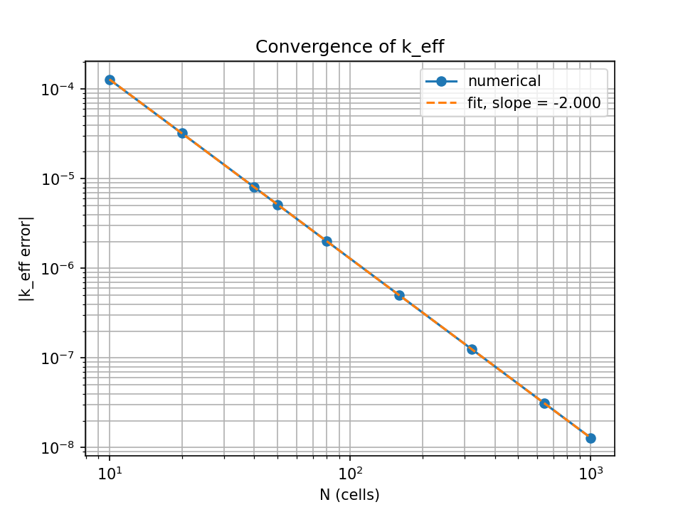
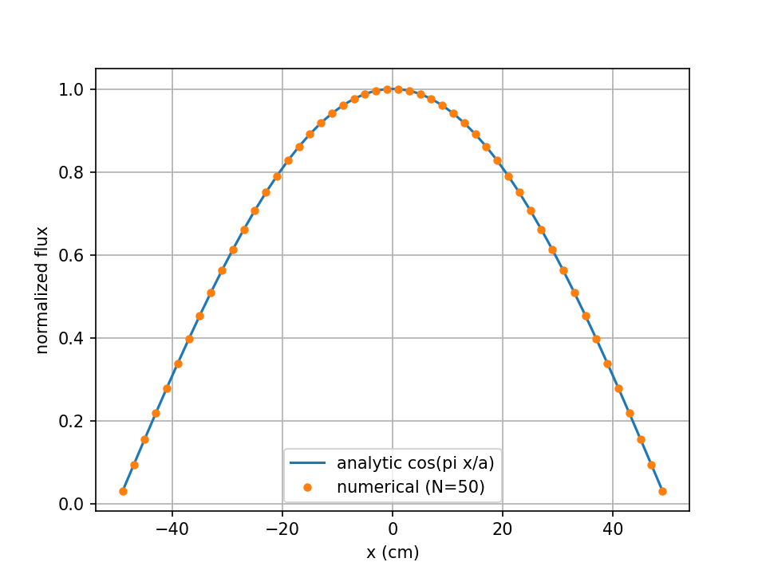

# 1-D Neutron Diffusion Criticality Solver (C++17)

A from-scratch solver for the one-group neutron diffusion eigenvalue problem on a bare 1-D slab. It finds $k_{\text{eff}}$ and the fundamental flux shape by power iteration, using a hand-written Thomas (tridiagonal) solver, and is verified against the analytic solution.

## The problem

$$-D\,\phi'' + \Sigma_a\,\phi = \frac{1}{k}\,\nu\Sigma_f\,\phi, \qquad \phi(\pm a/2) = 0$$

Analytic results for a bare slab:

$$B^2 = \left(\frac{\pi}{a}\right)^2, \qquad k_{\text{eff}} = \frac{\nu\Sigma_f}{\Sigma_a + D B^2}, \qquad \phi(x) = \cos\\left(\frac{\pi x}{a}\right)$$

## Method

| Piece | Choice |
|---|---|
| Discretization | Cell-centered finite differences, $N$ cells, $h = a/N$ |
| Boundary | Ghost cell $\phi_0 = -\phi_1$ (zero flux at the wall), giving diagonal $3c+\Sigma_a$ in the end rows, with $c = D/h^2$ |
| Linear solve | Thomas algorithm, $O(N)$, written from scratch (`thomas.cpp`) |
| Eigenvalue | Power iteration with fission-source ratio update $k_{\text{new}} = k_{\text{old}}\,S_{\text{new}}/S_{\text{old}}$ |
| Stopping rule | $\lvert\Delta k\rvert < 10^{-12}$ and max flux change $< 10^{-12}$ |
| Dependencies | None for the solver (g++ and make only). Python, NumPy and matplotlib for checks and plots |

## Test case

$D = 1.0$ cm, $\Sigma_a = 0.07$ cm$^{-1}$, $\nu\Sigma_f = 0.08$ cm$^{-1}$, $a = 100$ cm. Analytic $k_{\text{eff}} = 1.12696753747$.

## Build and run

```bash
mkdir -p results
make                      # builds ./diffusion and ./test_thomas
./test_thomas             # unit tests for the Thomas solver
./diffusion 100           # solve with N = 100 cells (default)
python3 eig_check.py      # independent NumPy eigenvalue cross-check
```

Convergence study and plots:

```bash
echo "N,k_numerical,k_analytic,k_error,max_flux_error,iterations" > results/convergence.csv
for n in 10 20 40 80 160 320 640 1000; do ./diffusion $n > /dev/null; done
./diffusion 50 > /dev/null && cp results/flux.csv results/flux_N50.csv
python3 plot.py
```

## Results

**Verification at the finest meshes**

| Check | Result |
|---|---|
| $k_{\text{eff}}$ error, $N=100$ | $1.29\times10^{-6}$ |
| $k_{\text{eff}}$ error, $N=200$ | $3.22\times10^{-7}$ |
| NumPy `eigvalsh` cross-check ($N=100$) | $k = 1.126968826131$ vs. C++ $1.12696882613$ |
| Max normalized flux error vs. $\cos(\pi x/a)$ | $\approx 6.6\times10^{-12}$ (at the stopping tolerance) |
| Power iterations to converge | 238 (at $N \geq 160$) |

**Convergence of $k_{\text{eff}}$ (second order)**

| $N$ | $k_{\text{eff}}$ | error | ratio to previous row |
|---|---|---|---|
| 10 | 1.12709599867 | $1.285\times10^{-4}$ | n/a |
| 20 | 1.12699972935 | $3.219\times10^{-5}$ | 3.99 |
| 40 | 1.12697559024 | $8.053\times10^{-6}$ | 4.00 |
| 80 | 1.12696955096 | $2.013\times10^{-6}$ | 4.00 |
| 160 | 1.12696804087 | $5.034\times10^{-7}$ | 4.00 |
| 320 | 1.12696766332 | $1.258\times10^{-7}$ | 4.00 |
| 640 | 1.12696756894 | $3.146\times10^{-8}$ | 4.00 |

Fitted log-log slope of error vs. $N$: **-2.000**.




## Notes on the results

- The discrete flux is exactly $\cos(\pi x_i/a)$ sampled at the cell centres $x_i = -a/2 + (i-\tfrac12)h$, so all of the discretization error is in the eigenvalue. The leakage term becomes $2c(1-\cos(\pi/N))$ instead of $D(\pi/a)^2$, which differs at $O(h^2)$.
- The remaining flux error is set by the iteration tolerance, not by the mesh.
- Convergence speed is controlled by the dominance ratio $k_2/k_1$. The flat starting guess is symmetric, so it contains almost no antisymmetric mode, and the slowest surviving mode is the third.

## Limitations

- This is **verification** (the equations are solved correctly), not **validation** (the equations match a real reactor). In real diffusion theory the flux extrapolates to zero about $2.13D$ beyond the surface, so $a$ should be the extrapolated width. This code uses $\phi(\pm a/2)=0$ as specified.
- One energy group, homogeneous bare slab, no reflector.

## Files

| File | Purpose |
|---|---|
| `thomas.hpp`, `thomas.cpp` | Tridiagonal solver |
| `test_thomas.cpp` | Unit tests (3x3 hand case, N=4 diffusion matrix) |
| `main.cpp` | Matrix assembly, power iteration, verification, CSV output |
| `eig_check.py` | NumPy eigenvalue cross-check |
| `plot.py` | Convergence and flux-overlay plots |
| `Results.md` | Recorded numbers from each milestone |
| `Makefile` | Build rules |
